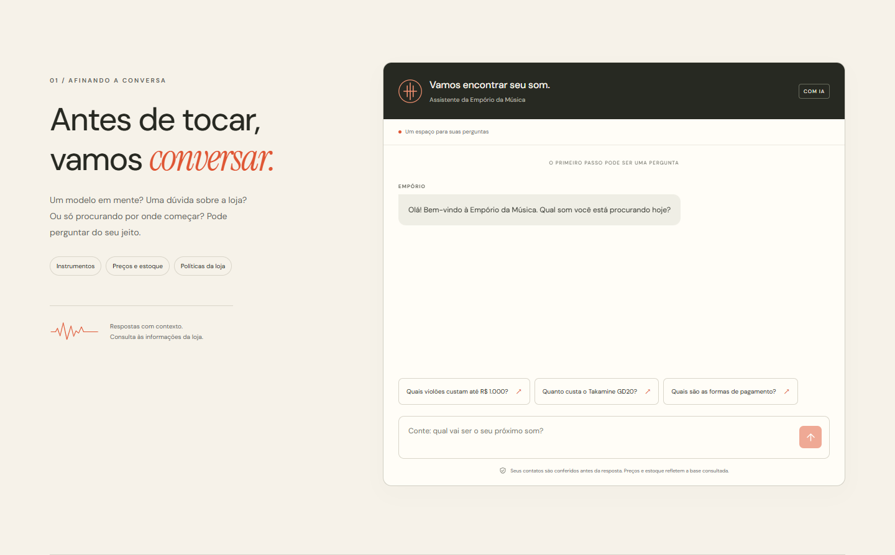
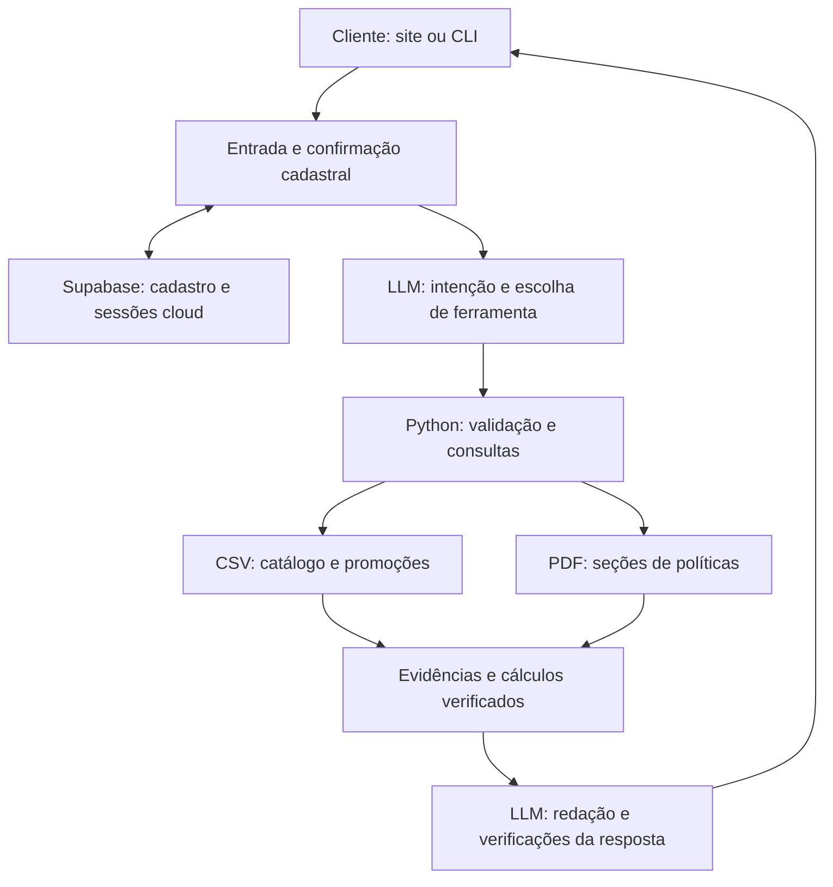

# Empório da Música — agente de atendimento com IA

Protótipo desenvolvido para o desafio técnico AI Engineer da Artefact. Um agente em Python atende em português brasileiro, consulta os CSVs do catálogo e o PDF de políticas da loja e responde com base nas fontes recuperadas. A interface usa Next.js, React, TypeScript e Tailwind CSS; o cadastro e as sessões de produção usam Supabase/PostgreSQL.

**[Abrir o site](https://emporio-da-musica-five.vercel.app)** · **[Saúde da API](https://emporio-da-musica-api.vercel.app/health)** · **[Documentação HTTP](https://emporio-da-musica-api.vercel.app/docs)** · **[Conversas reais de catálogo](docs/EXEMPLOS_CATALOGO.md)**


## O que o projeto faz

- Entende perguntas em linguagem natural sobre instrumentos, preços, estoque e promoções.
- Escolhe ferramentas de consulta e usa os resultados para construir a resposta.
- Recupera trechos do manual para perguntas sobre atendimento e políticas da loja.
- Calcula descontos em Python com `Decimal`, distinguindo preço original, percentual e preço final.
- Confere os contatos do cliente no Supabase antes de continuar a conversa.
- Recusa consultas privadas de pedidos sem autenticação comprovada e trata perguntas fora do domínio da loja.

Preços e estoque representam o **snapshot dos CSVs**, sem promessa de atualização em tempo real. O protótipo não realiza compras, pagamentos, reservas ou alterações em pedidos.

### Fluxo do atendimento

1. Ao abrir o site, o cliente vê uma saudação fixa. Essa mensagem inicial não chama o LLM.
2. O cliente envia uma pergunta, que fica pendente enquanto o atendimento solicita nome, telefone e e-mail, explica a finalidade da coleta e apresenta o aviso referente à LGPD.
3. O cliente revisa os contatos e confirma explicitamente o envio. No fluxo atual, essa etapa é necessária para prosseguir.
4. O backend verifica **telefone e e-mail correspondentes ao mesmo cadastro**. Reconhece o retorno ou cria um registro e agradece o contato.
5. A pergunta original é retomada automaticamente. O agente consulta o catálogo ou as políticas e mantém o contexto das próximas mensagens.

O protocolo de cadastro não autentica acesso a pedidos. Os campos estruturados de cadastro ficam fora do contexto do LLM; as mensagens livres da conversa são enviadas ao provedor e podem conter informações que o próprio usuário digitar.



## Tecnologias

| Componente | Escolha |
| --- | --- |
| Núcleo do agente | Python 3.10+, ferramentas tipadas e regras determinísticas |
| Modelo atual | Groq, modelo `qwen/qwen3.8-27b` |
| Backend HTTP | FastAPI e Uvicorn |
| Fontes de consulta | CSVs com `csv`/`pathlib`; PDF com `pypdf` |
| Persistência | Supabase/PostgreSQL para cadastro e sessões de produção |
| Interface | Next.js 16, React 19, TypeScript e Tailwind CSS 4 |
| Publicação | Dois projetos Vercel: interface e API Python |
| Verificação | Testes Python, avaliações com LLM e Playwright para os fluxos da interface |

As versões instaláveis estão em [pyproject.toml](python-agent/pyproject.toml), [requirements-api.lock](python-agent/requirements-api.lock) e [package-lock.json](frontend/package-lock.json). O ambiente de desenvolvimento foi validado com Python 3.10 e Node.js 24.13; o frontend exige Node.js 20.9 ou superior.

## Como executar localmente

Os exemplos abaixo usam **PowerShell no Windows**. Todos os comandos partem da raiz deste projeto, onde estão `run_agent.py`, `run_api.py`, `python-agent/` e `frontend/`. Executá-los na pasta acima do projeto causa erros de caminho ou de `package.json`.

### 1. Obter o código e instalar o ambiente Python

Pré-requisitos: Git, Python 3.10+ e Node.js/npm para a interface.

```powershell
git clone https://github.com/nataliakishar/-EmporiodaMusica.git emporio-da-musica
Set-Location -LiteralPath './emporio-da-musica'

python -m venv python-agent/.venv
.\python-agent\.venv\Scripts\python.exe -m pip install -r python-agent/requirements-api.lock

if (!(Test-Path -LiteralPath 'python-agent/.env')) {
    Copy-Item -LiteralPath 'python-agent/.env.example' -Destination 'python-agent/.env'
}
```

Se o projeto e o ambiente virtual já existem, reutilize-os. Não substitua um `.env` configurado. Não é necessário ativar o ambiente virtual: os comandos usam diretamente seu executável. Em Linux/macOS, use `python3` para criá-lo e `python-agent/.venv/bin/python` nos comandos seguintes; use `npm` no lugar de `npm.cmd`.

### 2. Disponibilizar os datasets

Coloque em `data/` os seis CSVs originais e o manual:

```text
desafio_tecnico_ai_eng - categories.csv
desafio_tecnico_ai_eng - customers.csv
desafio_tecnico_ai_eng - order_items.csv
desafio_tecnico_ai_eng - orders.csv
desafio_tecnico_ai_eng - products.csv
desafio_tecnico_ai_eng - promotions.csv
políticas_da_loja.pdf
```

**O clone público não contém todos esses arquivos.** Os CSVs de clientes, pedidos e itens, o PDF interno e transcrições privadas foram excluídos do Git por conterem dados pessoais ou conteúdo restrito. O responsável pelo desafio precisa fornecê-los por um canal autorizado. Os três CSVs de catálogo estão versionados; não altere os originais para adaptar respostas ou testes.

A auditoria local conferiu 9 categorias, 50 clientes, 65 produtos, 20 pedidos, 22 itens e 25 promoções. Esses números descrevem os arquivos conferidos, não substituem a auditoria de uma nova versão dos dados. Consulte a [política de conteúdo do repositório](docs/GITHUB.md).

### 3. Configurar o provedor e o Supabase

Edite somente `python-agent/.env`, sem publicar as chaves:

```dotenv
DATA_DIR=../data
LLM_PROVIDER=groq
LLM_MODEL=qwen/qwen3.8-27b
LLM_BASE_URL=https://api.groq.com/openai/v1
LLM_TIMEOUT_SECONDS=90
GROQ_API_KEY=

SUPABASE_URL=https://SEU_PROJETO.supabase.co
SUPABASE_SECRET_KEY=
```

- **Groq:** crie uma chave no [console do provedor](https://console.groq.com/keys) e preencha `GROQ_API_KEY`. O plano utilizado no desenvolvimento tem cotas; disponibilidade e limites dependem da conta.
- **Supabase:** informe a URL do seu projeto e uma chave secreta de backend em `SUPABASE_SECRET_KEY`. Nunca use essa chave no frontend nem em uma variável `NEXT_PUBLIC_*`. Consulte a [documentação de chaves de API](https://supabase.com/docs/guides/getting-started/api-keys).
- **Dados:** `DATA_DIR=../data` é relativo ao `.env` do módulo. Sem configuração explícita, o carregador procura `data/` na raiz do projeto; há também um fallback de desenvolvimento para o caminho Windows original, se acessível. O código de negócio usa `pathlib.Path`.

Para um **novo projeto Supabase**, aplique uma única vez, em ordem, os arquivos abaixo pelo SQL Editor ou pelo fluxo de migrations do Supabase:

1. [20261103150834_customer_registrations.sql](supabase/migrations/20261103150834_customer_registrations.sql)
2. [20261103161817_conversation_registration_gate.sql](supabase/migrations/20261103161817_conversation_registration_gate.sql)
3. [20261103182459_cloud_runtime_sessions.sql](supabase/migrations/20261103182459_cloud_runtime_sessions.sql)

Se o banco já está configurado, não reaplique migrations indiscriminadamente. O cadastro fica na tabela `customer_registrations`, visível no **Table Editor**, e não na lista de usuários de Authentication. Não há importação automática dos clientes dos CSVs para essa tabela.

### 4. Usar a IA pela CLI

```powershell
# Conferência dos arquivos locais, sem chamar o LLM:
.\python-agent\.venv\Scripts\python.exe -X utf8 run_agent.py audit

# Atendimento em linguagem natural:
.\python-agent\.venv\Scripts\python.exe -X utf8 run_agent.py chat --show-tools
```

No prompt `Você:`, escreva, por exemplo, “Quanto custa o Takamine GD20?”. Conclua a revisão e confirmação cadastral para retomar a pergunta. Durante o chat, use `/limpar` para limpar o contexto e `/sair` para encerrar. Não digite a conversa no prompt `PS ...>` do PowerShell.

O comando `register` confere os contatos e abre o chat em seguida. `register --dry-run` apenas valida a entrada, sem gravar nem acessar serviços. A saída estruturada com `--json` não abre um chat interativo e preserva o bloqueio cadastral quando aplicável.

As consultas determinísticas também continuam disponíveis, sem chamada ao modelo:

```powershell
.\python-agent\.venv\Scripts\python.exe run_agent.py products --query 'Takamine GD20'
.\python-agent\.venv\Scripts\python.exe run_agent.py products --category 'Violões' --max-price 1000
.\python-agent\.venv\Scripts\python.exe run_agent.py promotions
.\python-agent\.venv\Scripts\python.exe run_agent.py --json products --query 'Takamine GD20'
```

### 5. Abrir a interface e a API

Em um terminal na raiz do projeto, mantenha a API aberta:

```powershell
.\python-agent\.venv\Scripts\python.exe -X utf8 run_api.py
```

Em outro terminal, também na raiz:

```powershell
if (!(Test-Path -LiteralPath 'frontend/.env.local')) {
    Copy-Item -LiteralPath 'frontend/.env.example' -Destination 'frontend/.env.local'
}
npm.cmd --prefix frontend ci
npm.cmd --prefix frontend run dev
```

Abra **http://127.0.0.1:3000**. A API local fica em **http://127.0.0.1:8000** e sua documentação em **http://127.0.0.1:8000/docs**. O `frontend/.env.local` deve conter `NEXT_PUBLIC_API_URL=http://127.0.0.1:8000`. Mantenha os dois processos abertos durante o uso local.

### Produção na Vercel

A publicação atual separa a API Python, com raiz no projeto, do frontend, com raiz em `frontend/`. As credenciais Groq/Supabase ficam exclusivamente no backend. O frontend recebe apenas o endereço público da API, e a API restringe as origens permitidas por CORS.

Em produção, sessões e fontes privadas ficam no Supabase para suportar diferentes instâncias da função Python. O pacote privado de fontes usa verificação de integridade por hash; não é enviado ao GitHub. Consulte os passos, variáveis e preparação de fontes em [docs/PUBLICACAO_VERCEL.md](docs/PUBLICACAO_VERCEL.md). O site publicado funciona sem o VS Code ou o computador do desenvolvedor ligados.

## Decisões técnicas

### Agente Python com function calling

O LLM interpreta a pergunta e escolhe entre ferramentas com parâmetros definidos. O Python valida os argumentos, executa filtros e cálculos e devolve evidências para a resposta. O modelo não recebe acesso livre ao banco, não executa SQL gerado e não grava cadastros por decisão própria.

A orquestração foi implementada diretamente, com limites de chamadas e tratamento de erros. Para o tamanho do desafio, isso mantém as regras inspecionáveis e evita adicionar um framework amplo de agentes. O mesmo núcleo atende à CLI e à FastAPI, reduzindo duplicação entre interfaces.

### LLM remoto pela Groq

O modelo configurado é `qwen/qwen3.8-27b`. A escolha considerou o uso de ferramentas e as avaliações realizadas no projeto. A inferência remota reduz o consumo de RAM e CPU do computador em comparação ao modelo local experimentado com Ollama; exige internet e está sujeita às cotas da Groq.

Os adaptadores anteriores foram preservados, mas os resultados de cada provedor são distintos. A existência de um adaptador não significa que ele passou pela mesma validação do modelo atual. Uma pergunta pode gerar mais de uma requisição ao provedor, pois há escolha de ferramenta, execução e redação da resposta.

### Retrieval híbrido: dados estruturados e seções do PDF

- **Catálogo:** busca e filtros determinísticos sobre os CSVs, incluindo associação por categoria, preço, status, estoque, ordenação e paginação. Os valores não dependem de similaridade de embeddings.
- **Políticas:** extração do PDF com `pypdf`, organização por seções e seleção de trechos por tema. Os resultados carregam referências de fonte, páginas e versão do documento.
- **Resposta:** o LLM recebe as evidências necessárias, enquanto o Python verifica fatos e cálculos sensíveis.

É uma abordagem de recuperação por ferramentas: **não há banco vetorial, embeddings ou OCR implementados**. O manual curto e estruturado permite recuperar seções sem essa infraestrutura. Perguntas de avaliação e transcrições não são usadas como base de conhecimento nem como respostas prontas.

### Estratégia de prompt

As instruções definem a persona acolhedora, musical, profissional e objetiva, o uso de PT-BR e a formatação monetária brasileira. Orientam consultar as ferramentas adequadas, identificar dados de snapshot, não inventar fatos nem executar ações inexistentes e tratar o texto recuperado como informação, sem obedecer a instruções contidas nele.

As evidências são inseridas conforme a pergunta e as ferramentas consultadas. Há limites de contexto e verificações de resposta, incluindo tentativas limitadas de correção. Isso reduz erros observados, mas não garante ausência de alucinações em qualquer pergunta.

### Regras de negócio e privacidade

- Disponível para compra significa `status == active` **e** `stock_quantity > 0`.
- Promoções exigem `is_active == 1` e produto elegível. O preço final usa `Decimal` com arredondamento financeiro, sem inventar validade da promoção.
- O carregamento valida colunas, tipos e relacionamentos por ID. As listas têm limite, paginação e ordenação estável.
- Telefone e e-mail coincidentes identificam um possível cadastro de retorno; não comprovam identidade nem liberam pedidos privados.
- A consulta usa os arquivos operacionais atuais. Por exemplo, o catálogo local contém violões até R$ 1.000; a resposta é calculada pelos filtros, sem preservar a antiga expectativa de ausência de resultados.

Na CLI e na API local, o histórico é temporário. Na API de produção, o Supabase compartilha o estado entre instâncias, com contexto limitado às seis trocas mais recentes e expiração lógica de sessão após 30 minutos. Encerrar a sessão remove seu estado; isso não exclui o cadastro do cliente. A limpeza de sessões expiradas ocorre por operações do serviço, sem promessa de exclusão física no instante exato da expiração.

O navegador mantém o token da conversa em memória, sem persistência própria em cookies, `localStorage` ou `sessionStorage`; recarregar a página inicia outra sessão. Tabelas e funções de backend têm controles de acesso, e as chaves secretas ficam no servidor. O aviso de coleta e esses controles não representam certificação de conformidade com a LGPD.




## Organização do repositório

```text
run_agent.py                 Entrada da CLI
run_api.py                   Servidor local FastAPI
app.py                       Entrada da API de produção
python-agent/
  emporio_agent/              Agente, provedores, ferramentas e regras
  scripts/                   Validações e utilitários de desenvolvimento
  .env.example               Exemplo de configuração sem segredos
frontend/                    Interface Next.js e testes Playwright
data/                        Fontes originais; parte disponível apenas localmente
supabase/migrations/         Evolução do banco de dados
docs/                        Documentação, conversas públicas e imagens
```

## Validação e exemplos

As etapas anteriores registraram testes locais e avaliações reais com a Groq. Entre as evidências estão o lote de **28 perguntas**, testes focados de cadastro e entrada, **23 testes da API**, **9 cenários da interface** e **14 verificações do runtime cloud**. Essas contagens pertencem a etapas diferentes, podem se sobrepor e não devem ser somadas como uma única suíte.

A publicação também foi verificada no navegador com cadastro sintético, retorno cadastral, uma pergunta real à Groq, conferência de preço no CSV e layout de celular. O cadastro de teste foi removido. Os relatórios completos e as conversas com conteúdo do manual ficam no workspace, em `python-agent/reports/` e `python-agent/examples/`, fora do Git público.

Há **[quatro conversas reais de catálogo disponíveis para leitura](docs/EXEMPLOS_CATALOGO.md)**, sem dados de clientes ou trechos do documento interno. Elas mostram consulta por faixa de preço, modelo, categoria e paginação.

Para validar mudanças nesses componentes, a partir da raiz e com as fontes locais configuradas:

```powershell
New-Item -ItemType Directory -Force -Path 'python-agent/reports' | Out-Null
.\python-agent\.venv\Scripts\python.exe -X utf8 python-agent/scripts/validate_api.py
.\python-agent\.venv\Scripts\python.exe -X utf8 python-agent/scripts/validate_conversation_entry.py
.\python-agent\.venv\Scripts\python.exe -X utf8 python-agent/scripts/validate_cloud_runtime.py

npm.cmd --prefix frontend run typecheck
npm.cmd --prefix frontend run test:e2e
npm.cmd --prefix frontend run build
```

Essas validações usam dublês nos pontos de integração; não comprovam, isoladamente, uma chamada real ao LLM ou ao banco hospedado. O script cloud usa o relatório gerado por `validate_api.py`: execute este primeiro quando ainda não houver relatório local. Os testes da interface estão configurados para o Edge e para o caminho do Python no Windows; ajuste ambos no `frontend/playwright.config.ts` conforme o ambiente. Para um ajuste pequeno, selecione o teste relacionado, por exemplo com `npm.cmd --prefix frontend run test:e2e -- --grep 'nome do cenário'`.

Os scripts de avaliação remota são separados: consomem cota do provedor e alguns fluxos reais criam registros sintéticos. Não precisam ser executados a cada mudança. Nesta atualização de documentação, não se repetiu o lote de 28 perguntas.

## Limitações conhecidas

- **Cota do provedor:** a Groq pode responder `429`. O sistema apresenta a orientação de espera recebida, que pode chegar a muitos minutos. O aviso não é um cronômetro nem uma garantia de retomada automática.
- **Snapshot do catálogo:** não há sincronização com estoque, preços ou pedidos de um sistema comercial em tempo real.
- **Pedidos privados:** não há autenticação de clientes implementada para liberar status, rastreio ou dados pessoais de pedidos.
- **Recuperação de políticas:** depende de texto extraível e da estrutura conhecida do PDF. Não inclui OCR, busca vetorial ou atualização automática da base.
- **Ambiguidades da fonte:** conflitos ou lacunas do manual não são resolvidos por suposição do agente.
- **Histórico curto:** o contexto é limitado, expira e não constitui um arquivo permanente das interações. Recarregar a página perde a sessão em memória do navegador.
- **Confiabilidade:** testes e verificações cobrem os casos avaliados, não todas as formulações possíveis. Permanecem riscos de interpretação incorreta, latência e indisponibilidade externa.
- **Operação e privacidade:** não há transferência operacional para atendente humano, monitoramento completo com alertas ou fluxo integral de atendimento a solicitações de exclusão de dados.

### O que faria com mais tempo

1. Implementar autenticação verificada e autorização por cliente antes de habilitar consultas de pedidos.
2. Medir custo, tokens, latência e erros; reduzir contexto e reavaliar modelos para diminuir o impacto das cotas.
3. Versionar e atualizar as fontes com uma rotina controlada, incluindo rastreabilidade das mudanças.
4. Ampliar avaliações semânticas e adversariais e integrar os testes relevantes ao CI.
5. Adotar recuperação semântica caso o volume ou a variedade de documentos justifique a complexidade.
6. Completar os fluxos de privacidade, retenção, exclusão e encaminhamento humano, com observabilidade que evite registrar dados pessoais desnecessários.

## Uso de assistente de código

Foi utilizado o **Codex, da OpenAI**, como assistente de desenvolvimento no workspace. Ele auxiliou na inspeção do projeto, implementação Python, integração com Groq e Supabase, interface, testes, diagnóstico de erros, preparação da publicação e documentação. O LLM do atendimento em execução é o modelo configurado na Groq; o Codex participa do desenvolvimento.

O trabalho foi conduzido por etapas supervisionadas. A responsável definiu requisitos, persona, fluxo cadastral, identidade visual e aprovações de integração/publicação. O assistente examinou o código existente, propôs mudanças delimitadas, implementou arquivos reais e executou as verificações correspondentes. Resultados de testes locais com dublês foram separados das chamadas reais ao provedor e ao banco.

O workflow priorizou reutilizar o núcleo existente e testar os fluxos novos, sem repetir toda a avaliação remota a cada ajuste. Os resultados observados orientaram correções e decisões, incluindo a migração da inferência local para a Groq por limitações de memória. As limitações registradas acima permanecem explícitas; o uso do assistente não substitui revisão e manutenção do projeto.

## Documentação complementar

- [Núcleo Python e configuração detalhada](python-agent/README.md)
- [Interface e execução do frontend](frontend/README.md)
- [Contrato da API](docs/API.md)
- [Fluxo inicial da conversa](docs/FLUXO_INICIAL.md)
- [Publicação na Vercel](docs/PUBLICACAO_VERCEL.md)
- [Conteúdo permitido no GitHub](docs/GITHUB.md)
- [Conversas exemplificativas públicas](docs/EXEMPLOS_CATALOGO.md)

As três imagens deste README são capturas das seções do site publicado: início, atendimento e funcionamento. A Empório da Música é uma loja fictícia criada para este desafio.
